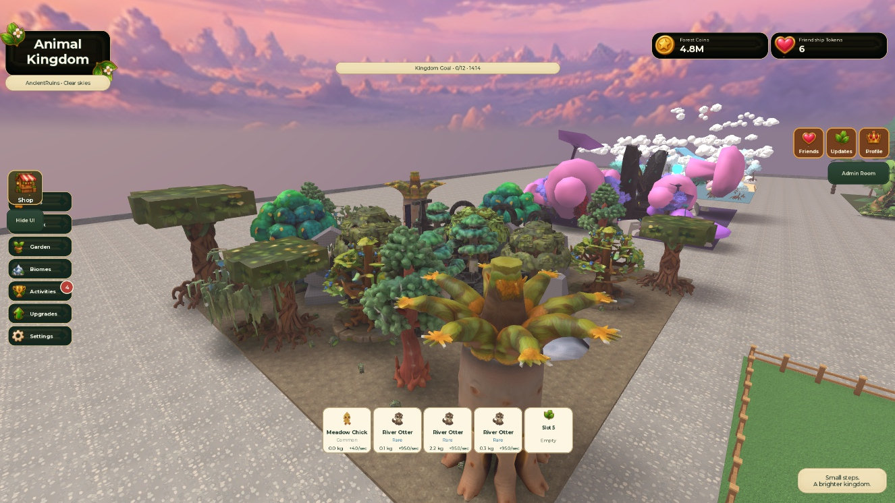

# Ancient Ruins tree overhaul checkpoint
Nine independent textured native tree families installed on all 22 original searchable tree instances: sacred banyan, moss oak, stone cedar, cypress, sentinel, vine fig, runic cedar, sacred willow and crown baobab. Heights 36–52 studs; 27 unique tree mesh IDs; 35 moss/fern/stone understory clusters. Existing altar and ruins architecture retained. Center clearing excluded from new understory.

Two generated families had three texture maps that failed in the real client. Those templates are retained in the Studio checkpoint and their receipts marked superseded in ancient-ruins-assets.json. Native cedar and willow replacements resolved the issue: actual client PreloadAsync confirmed all 27 active tree texture maps Success; final screenshot inspected with loaded textures.

Ocean and Ancient Ruins collision repair: hidden legacy canopies were obstructing WorldCheck interactive cover checks. Original tree instances, IDs, pivots, gameplay attributes, attachments and scripts retained. Hidden legacy parts' collision/query/touch flags are saved as AK8Original attributes and disabled; narrow 5.5×12×5.5 invisible trunk proxies retain physical trunks and raycast ancestry. New mesh visuals and understory remain non-colliding. Source apply is idempotent.

Runtime Script checks: all 265 unfinished-tree records retain COMING SOON gates; Ocean and Ancient Ruins Gather rejected with existing message and unchanged player data. Client Ancient Ruins:22 visuals,66 mesh parts,27 unique IDs,zero mesh-visual physics failures. Existing SacredDust pool active ~34.11/s. Humanoid walk probes:Ocean18.75 studs,AncientRuins18.47 studs over2.5seconds; both finish within1.53studs of targets.

Desktop sample:465frames over8.015seconds,mean17.24ms,peak287.35ms,one frame above50ms. Keep the hitch as a reproduction lead; no mobile or multiplayer performance claim.

Approved Meadow,Forest,Snow,Volcano fingerprint unchanged:hash3138740795,498184bytes,1531instances. Save shortcut issued; Stop/Play retained changes. Full Studio close/reopen still pending. No paid ForgeGUI calls; no experience publication.

WorldCheck after collision repair:2errors,1warning;49tree interactives checked. Remaining findings:existing Plot4Spawn overlap with an old Scene mesh;preserved ruins altar covers floor-center ray;multiple neutral plot spawns warning. Earlier per-part probe had11errors; whole-tree adapter corrected that to4 before repair,then2 after. All probe failures are retained in asset ledger. Unchanged UI audit:25 existing findings across337 elements; UI provenance outside tree-overhaul scope. These prevent a blanket all-QA-pass claim.

