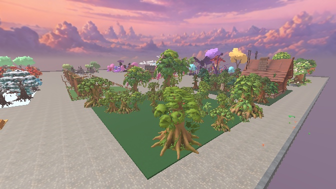
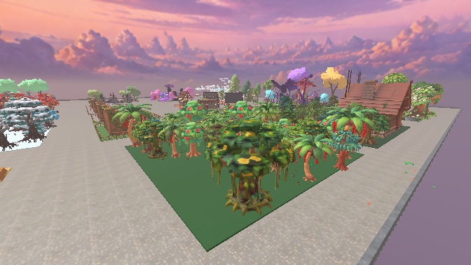
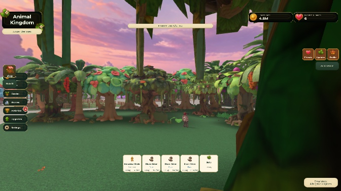
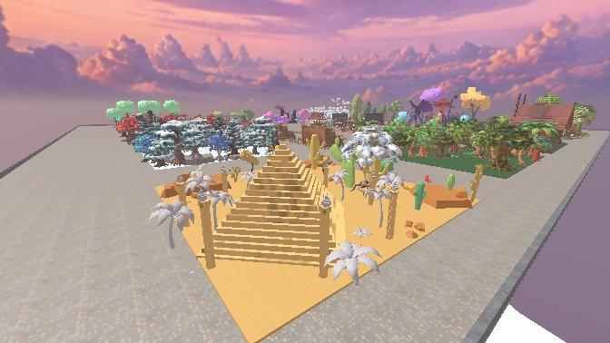
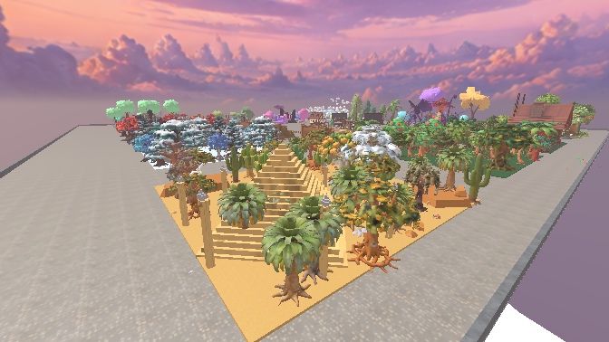
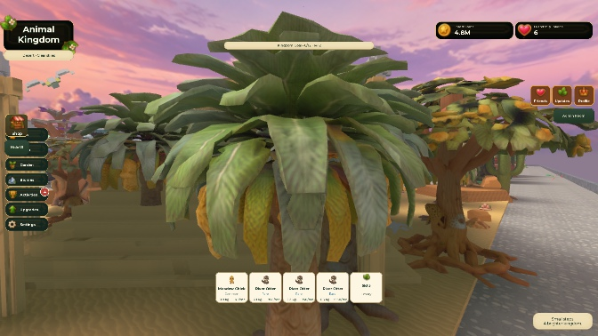

# Final eight biome overhaul — Jungle checkpoint
Jungle: 35 searchable visuals replaced with eight distinct textured native Roblox models and 54 tropical understory clusters. Height range 36–52 studs; 24 distinct tree mesh IDs. Existing tree instances, attributes, pivots and gameplay geometry retained. Future biomes remain Coming Soon.

Approved Meadow, Forest, Snow and Volcano unchanged: checksum 632889028, 336304 bytes, 1070 protected descendants before and after Edit/Play. Approved source mesh library unchanged; new assets are isolated in AK_FinalEightTreeTemplates.rbxmx.

Actual Studio Play QA: all 265 future tree resource records and Coming Soon prompts/gates pass, player data unchanged; 8 Jungle canopies moving, active ambient particle rate about 30.17/s. Added tree visual physics failures: 0. Installer boot installed 0/retained 35, proving idempotence. Gameplay and visual screenshots captured. Existing Superbullet localhost and pet asset warnings persist; no new installer errors.

ForgeGUI read-only route/catalog preflight succeeded; jungle catalog search returned no assets. Used successful native Studio generation, without paid ForgeGUI calls. Nine published model IDs, generation IDs, meshes/textures and serialized source in jungle-assets.json. Publication of model assets does not publish the experience.

Remaining: Desert, Ocean, Ancient Ruins, Magical Forest, Sky, Prehistoric, Mythical. Physical mobile/multiplayer performance and full Studio close/reopen verification remain pending. Do not mark the entire task complete.

## Desert checkpoint
19 searchable visuals across eight native textured families, 30 ground-detail clusters and 12 native decorative trees replace three merged untextured decorative palm meshes. Pyramid/terrain retained; old decorative mesh render/collision settings backed up to remove invisible decorative obstacles. Original searchable tree gameplay geometry remains unchanged. Models use24 distinct mesh IDs. Recoverable moderation failures documented; alternatives succeeded.
Actual Play: all265 records/prompts/gates pass, data unchanged, zero new visual physics failures, two nearby moving canopies, active ambient particles4.56/s. Approved4 hash unchanged. Remaining six biomes and hardware/reopen QA pending.

