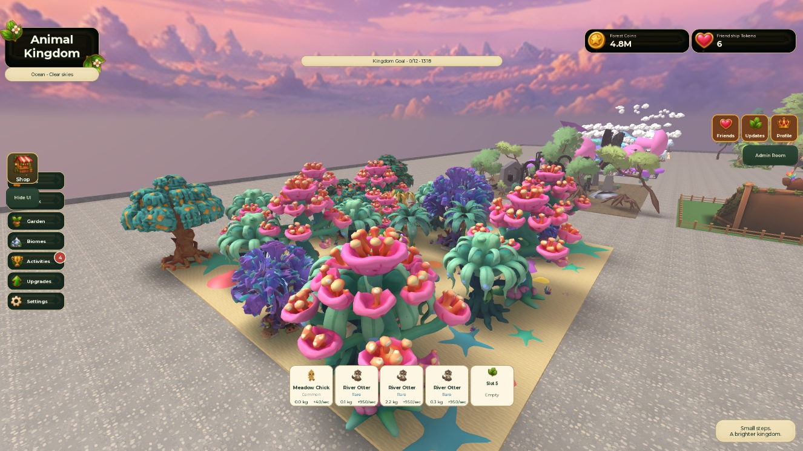

# Ocean tree overhaul checkpoint
Implemented eight independently generated textured families across 27 existing searchable tree anchors: staghorn coral, kelp, mangrove, fan coral, sea palm, anemone, pearl willow and bloom coral. Added 48 marine understory clusters. Installed heights 36–52 studs. 24 distinct tree mesh IDs; all replacement parts anchored with CanCollide, CanQuery and CanTouch disabled. Original tree instances, pivots, gameplay attributes and hidden query/collision geometry retained.

Reused six native Studio designs recovered from the interrupted session; generated two missing trees and one understory cluster with native Studio generation. No paid ForgeGUI calls; no experience publication. Native generation IDs, meshes/textures and complete template geometry are in ocean-assets.json and AK_OceanTreeTemplates.rbxmx. Recovered meshes needed cached geometry refreshed with AssetService/CreateMeshPartAsync and ApplyMesh before rendering; actual rendering was inspected afterward. ContentProvider string mesh preload returned Failure even for meshes that AssetService could create and the client rendered; this failed probe is retained here.

Actual runtime Script QA: Ocean 27 resource records; all 265 unfinished-biome records retain disabled COMING SOON prompts. Ocean Gather rejected with "This biome is coming soon!" and player data unchanged. Client: 27 visual instances, 81 mesh parts, 24 unique mesh IDs, zero replacement physics failures. Existing bubble pool active at approximately 36.59 particles/second near the Ocean center. Screenshot captured in a real client after skipping the intro and temporarily pinning its camera. Temporary probes removed by stopping Play.

Approved Meadow, Forest, Snow and Volcano fingerprint unchanged before/after Edit and Play: hash 3138740795, 498184 bytes, 1531 protected instances. This session's probe includes approved descendants and biome surfaces; it differs from the older checkpoint's scope.

Edit changes retained after Stop. Save shortcut issued. Full Studio close/reopen, hardware mobile and multiplayer performance verification remain pending. No final eight-biome completion claim.

