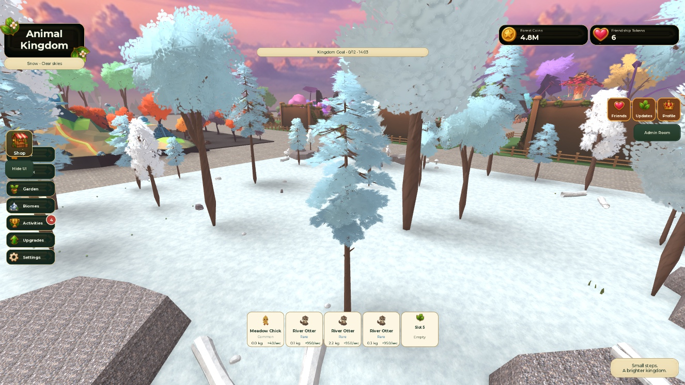
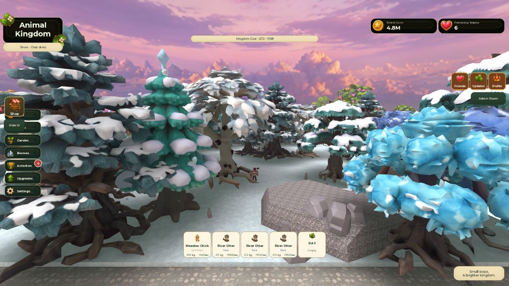
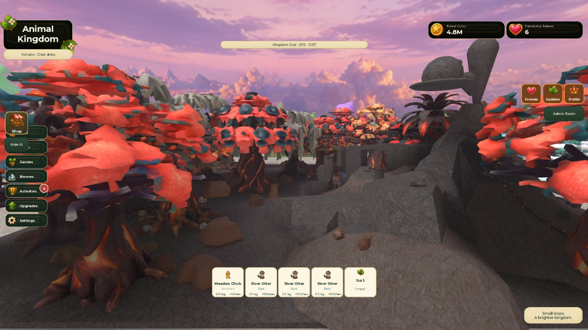

# Snow and Volcano visual correction — 2026-10-07

Status: Studio Testing / Partial. Other eight future biomes remain paused for visual acceptance.

## Implemented
- Read-only audit of the actual approved Meadow and Forest textured meshes and authored placement.
- Replaced 31 Snow and 26 Volcano tree visuals using 18 separately generated, textured native Roblox meshes: eight Snow families and ten Volcano families. Each has independently generated trunk/root, branch and foliage geometry; these are not recolored copies of one mesh.
- Snow: pine, crystalline fir, icy birch, larch, cedar, aspen, icewood and spruce.
- Volcano: ember umbrella, ash willow, cinder crown, banyan, thornwood, phoenix, cinder baobab, ember palm, ironwood and drake ash.
- Added 65 native mesh understory/rock clusters, with search-anchor clearance, central clearing and island-edge keep-outs.
- Corrected the existing island's lime/yellow surfaces to basalt/ash and cracked-lava tones without moving geometry or changing collisions.
- Retained original tree instances, pivots, attributes and collision/query geometry. Original rendering and previous replacement visuals are backed up in ServerStorage; Restore reverses rendering, detail and surface changes.
- The installer now operates only on Snow and Volcano. Existing other-biome work is retained in Studio and is not extended by this correction.
- Extended the existing client effect pool/tick; no additional heartbeat or physics wind simulation. Current Studio vegetation motion is delegated to its existing controller. The canonical source's older controller gets a bounded tween fallback for these two biomes, avoiding duplicate motion ownership.
- ForgeGUI generation exposes no verified free allowance; no paid ForgeGUI generation calls were made. Roblox Studio native mesh generation produced the assets. Initial prompt-length, upload rate-limit and concurrent generation failures were recovered through shorter prompts and limited requests.

## Measurements (studs)
| Biome | Trees measured | Median height | Median canopy/bounds width | Median nearest-anchor spacing |
| --- | ---: | ---: | ---: | ---: |
| Approved Meadow (new Tripo trees) | 15 | 48.69 | 50.17 | 31.20 |
| Approved Forest | 30 | 39.20 | 29.24 | 21.38 |
| Snow before | 31 | 36.04 | 14.28 | 22.88 |
| Snow corrected | 31 | 36.77 | 33.96 | unchanged |
| Volcano before (Models) | 24 | 23.21 | 19.66 | 24.23 |
| Volcano corrected (including two MeshPart anchors) | 26 | 46.88 | 43.74 | gameplay anchors unchanged |

Width is maximum horizontal bounding-box extent, not a manually segmented canopy diameter. Approved trunk colliders include Meadow ~8.83 studs and Forest ~6.72 studs; sculpted roots/branching were inspected visually in the actual textured meshes. Source model root/trunk meshes are retained in the asset XML for review. The two overlapping original island palm anchors have opposite 4.5-stud cosmetic offsets; authoritative anchors stay fixed.

## Actual Studio checks
- Correct instance/place: Animal Kingdom[TESTING}, place 132313449035787.
- Changes made in Edit, not temporary Play instances.
- Fresh playtest: all 265 future resource records and Coming Soon prompts passed; reward gates refused searches with the existing Coming Soon message, and player data was unchanged during those checks.
- Snow and Volcano live screenshots captured. Snow canopy CFrame movement measured in normal client rendering.
- Snow High continuous particle rate ~24.58/sec; Volcano quality rates Low 8.44, Medium 18.55, High 26.96, Ultra 33.79/sec. Animated vegetation counts 12/26/38/39, within existing culling/caps.
- Canonical tween fallback tested on isolated temporary geometry: moved=true, restored=true; scaffolding removed.
- New visuals: anchored; CanCollide/CanTouch/CanQuery false; zero invalid settings.
- Stop/Play retained 57 corrected visuals and 65 detail clusters.
- User accidentally closed Studio. Reopened the same place via its executable; new MCP connection found all 57 corrected visuals, 62 Studio templates and 65 clusters saved. No reconstruction was needed.
- Meadow/Forest protection checksum stayed hash 3464558833, 93,255 bytes, 285 instances throughout the checks, including after reopening.
- Native template XML passed Rojo 7.7.1 build.
- Existing Output warnings remain: Superbullet localhost:13528 unavailable and existing missing pet-model warnings. No replacement-installer errors in the reviewed boots.
- Screenshot blank frames occurred while Studio was minimized; restored/reopened viewport produced valid captures. Later comparison captures collided with the user's newly started intro and are excluded from evidence.

## Remaining verification
- User visual acceptance against approved Meadow/Forest at ground level and every family.
- Physical mobile-device frame time/memory and multiplayer tests; particle counts are not measured FPS.
- Full prompt/path walkthrough and event visuals on future trees once those biomes have real content and become eligible for Hot Trees. ContentReady remains restricted; no missing pets/rewards were fabricated.
- Repeat exact-angle Meadow/Forest side-by-side captures after the current user play session.
- Broader future-biome correction remains pending this benchmark.
- Git was written through the authenticated GitHub connector because the local clone has no HEAD after credential-manager failure. The repository handoff script cannot produce a valid local HEAD report; this is a tooling limitation, not a successful local git push.
- The latest source/controller changes are in Edit and local source; initial full mesh replacement persistence was verified by reopen. A save shortcut was issued for island polish; a second close/reopen after the final controller compatibility edits has not been performed.

No experience publication was performed.

## Captured evidence

