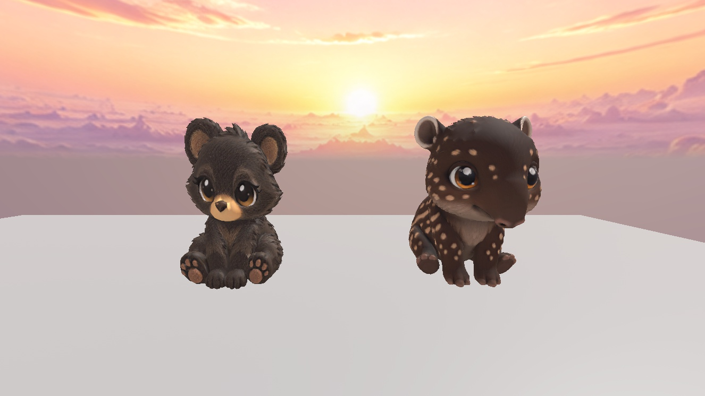

# Black bear stylization correction — blocked, pair incomplete

The user rejected the earlier Jungle models as too realistic. The OLD BLACK BEAR is now the primary design reference, with its front, side and three-quarter screenshots registered in ForgeGUI style version 4. Targets are giant rounded head, huge expressive glossy eyes, tiny muzzle, compact chubby body, short rounded limbs and richly painted/sculpted fur. New animals retain original species geometry; no bear mesh is used.

## Current result
- Rainstripe Tapir: new high-quality ForgeGUI model 106468658615650, mesh 94236683957011. Visible in Workspace.AK_JunglePetReview.PlushStylizedReview beside OriginalBlackBear_StyleReference. Both 2.8 studs high, same lighting. Forefeet grounded with 0.0203-stud settlement. Larger rounded head and eyes, rich juvenile markings/fur, no crest. Still a review candidate, not user-approved.
- Canopy Ocelot: two generated meshes were rejected for smooth fur; a native texture-only enhancement was also rejected for changed markings and weaker eyes. The latest concept ocelot-v7.png has the strongest rich painterly fur and exaggerated proportions.
- Latest Ocelot 3D job 47829b9a-859a-4f11-8bb4-78355893c50b FAILED with **Insufficient credits**, retryable false. No pending job remains. It is an account-balance failure, not a Codex approval rejection.
- The requested pair is NOT ready for final visual approval. Paid generation stopped; no subscriptions or credit packages bought.

## Durable sources and preservation
Local GLBs and extracted 4096px color/normal/ORM maps are saved in this directory. GLBs reopened successfully; indices, finite positions, UVs and normals validated, image decoding checked. Tapir durable Roblox asset was freshly reinserted and all PBR bindings matched. asset-manifest.json records every current source URL, hash/receipt, asset binding, blocker and resume request.
GitHub stores text records and review/reference images; large GLBs/textures are local with public source download URLs in the manifest.
Rejected Ocelot v2 model 118621881235687 remains durable but is not an accepted candidate. Its original PBR model and rejected texture attempt are archived.
All pre-revision Studio work is cloned in ServerStorage.AK_JungleBeforePlushCorrection_20261008. Earlier session-only EditableMesh/EditableImage edits still cannot be durably exported through the available tools; keep the Studio work saved/open. The new ForgeGUI models have durable asset IDs and local GLBs.

## Resume
After account credits are available, continue from ocelot-v7.png / mcp-artifact:5efd3604-96cf-4eae-86d9-3e1f47ac108b:0 and ocelot-model-v3-request.json. The failed job is explicitly non-retryable; do not blindly retry it or assume a refund. Use the supported generation workflow after resolving the balance. Verify rich fur and proportions in the resulting mesh, remove thin whisker strands, compare alongside the original bear and Tapir, then save/reopen before requesting final visual approval. Continue Tapir refinement if the comparison still warrants it.

## Spending
11 ForgeGUI image jobs; 4 high-quality model attempts (3 succeeded, 1 failed for insufficient credits); 1 rejected native texture enhancement. Actual charged credits were not exposed. No approval rejections or purchases occurred. All rejected attempts remain documented.
No new species, existing pet changes, Jungle unlock, active registry changes or game publication.

ForgeGUI history returned conversation ID a253c260-aa54-49c4-ad8b-be719f15482c and relative path /studio?tab=chat&conversation=a253c260-aa54-49c4-ad8b-be719f15482c; no absolute history URL was supplied.

