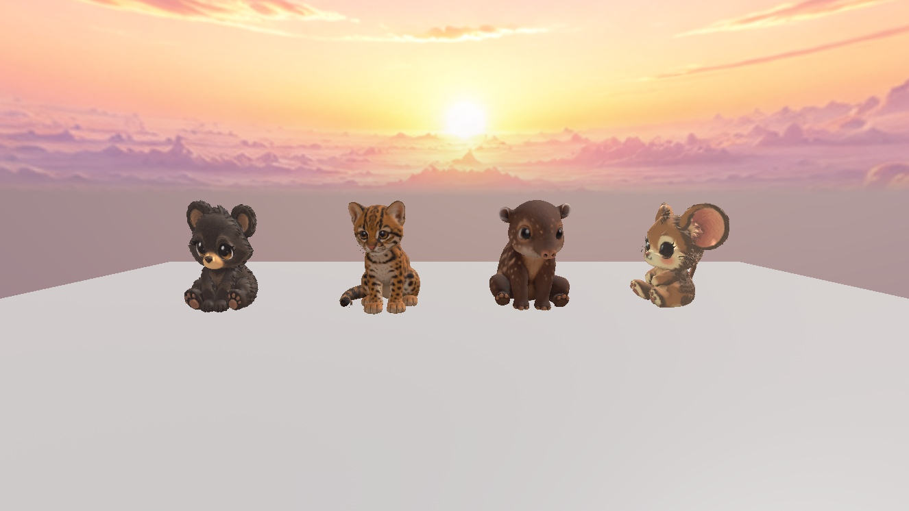

# Jungle seated furry pet review — awaiting visual approval

Rainstripe Tapir and Canopy Ocelot are original reference-guided high-quality ForgeGUI models. Ocelot replaces the Toucan candidate after checking the live species registry. Permanent style is recorded in ../../animal-kingdom-permanent-pet-style.json.

## Review
Open Workspace.AK_JunglePetReview.SeatedFurryReview. Left to right in comparison.jpg: Forest bear style reference, new Canopy Ocelot, new Rainstripe Tapir, Meadow mouse style reference. All are 2.8 studs high in the same lighting. Original Meadow/Forest templates were never modified.

Both candidates sit on their hindquarters with separate front feet forward on the floor. Source foot-height asymmetry is handled by tiny placement settlements (Tapir 0.00301 studs; Ocelot 0.02189 studs). This slightly intersects the other sole with the floor instead of leaving either foot floating. Fine Tapir fur is shorter than the bear's sculpted locks.

## Durable assets
- Rainstripe Tapir Roblox model: 70531496785746; mesh: 94683429753835; 16,167 triangles.
- Canopy Ocelot Roblox model: 80456788433707; mesh: 129768693773146; 15,617 triangles.
- Each model has 4096px embedded color, normal and ORM images, saved separately locally.
- asset-manifest.json includes public GLB source URLs, SHA256 hashes, model/texture IDs and validation.
- Local source directory: C:/Users/Kenny/Documents/Real_Animal_K/documentations/jungle-pets/seated-furry-20261008.
- Local GLB binaries and extracted textures are saved on disk; this GitHub checkpoint stores manifests, requests, inspection reports and screenshots, not the large binary GLBs.
- Both Roblox model IDs were freshly reinserted successfully into ServerStorage as ReopenCheck models. Their mesh IDs and every PBR binding match the review candidates.
- Local GLBs were reopened and validated for structure, indices, finite positions, normals and UVs; images decoded successfully.

## Preservation and limits
Previous Studio review work remains in ServerStorage.AK_JungleSeatedBeforeRevision_20261008_145855 and the original review objects remain intact. Older session-only EditableMesh/EditableImage work has no supported durable export through the available tools; the Studio backup does not survive closing without saving the place. New assets have durable Roblox IDs and local GLBs.

No existing pets, species registration, Jungle unlock or game publication changed. No runtime/animation integration claimed. Visual approval is pending.

## Method and spending
Reused successful ForgeGUI original concept -> furry reference refinement -> generation_model_3d quality high, Roblox style, direct GLB -> owned artifact publication -> Studio review. Exact prompts and request IDs are in checkpoint.json and model-requests.json. Forest bear screenshot supplied artistic style only; no existing mesh supplied to generation.

This revision used four image jobs and two high-quality 3D jobs. ForgeGUI did not expose the actual credit charge. Artifact publication does not repeat or charge generation. No subscriptions or credit packages purchased. No approval block occurred in this revision. A separate texture enhancement endpoint was unavailable; fur-reference refinement and high-quality generation supplied detailed 4K PBR textures.

